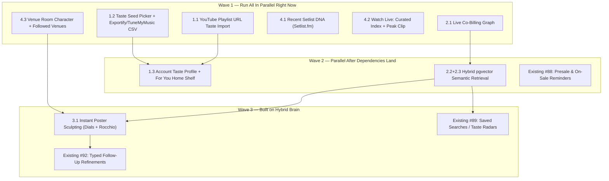

# Next-Wave Roadmap & Multi-Agent Execution Plan

This document coordinates the next vertical-slice wave across parallel worktree agents without merge collisions, while integrating cleanly with existing open GitHub issues (`#75`, `#88`, `#89`, `#92`).

## Dependency Graph

## File Ownership Map (Preventing Merge Collisions)

When running multiple agents in parallel worktrees (all branched from `development`), assign each slice clear primary modules and keep shared wiring (`app.py`, `config.py`, `models.py`, `globals.css`) minimal and additive:

| Slice | Primary Backend Files (Exclusive) | Primary Frontend Files (Exclusive) | Shared Touchpoints (Keep Tiny) |
|---|---|---|---|
| **1.1 YouTube Playlist Import** | `sources/youtube.py`, `tests/test_youtube_taste.py` | `components/youtube-import.tsx`, `lib/taste.ts` (additive) | `app.py` (1 route), `config.py` (1 key), `taste-panel.tsx` (1 tab) |
| **1.2 Taste Seed + CSV Presets** | `tests/test_suggest.py` + `suggest.py` | `components/taste-seed-picker.tsx`, `lib/taste-files.ts` | `app.py` (1 route), `taste-panel.tsx` (1 tab) |
| **2.1 Co-Billing Graph** | `cobilling.py`, `supabase/migrations/*_cobilling.sql`, `tests/test_cobilling.py` | *(backend-only slice)* | `matching.py`, `sync.py`, `pipeline.py` |
| **4.1 Setlist DNA** | `sources/setlistfm.py`, `tests/test_setlistfm.py` | `components/setlist-dna.tsx`, `lib/setlist.ts` | `app.py` (1 route), `config.py` (1 key), `ticket.tsx` (1 pane) |
| **4.2 Watch Live Clips** | `sources/live_clips.py`, `live_index.py`, `tests/test_live_clips.py` | `components/watch-live.tsx`, `lib/live-clips.ts` | `app.py` (2 routes), `ticket.tsx` (media toggle) |
| **4.3 Venue Character + Follow** | `sources/venues.py`, `supabase/migrations/*_followed_venues.sql`, `tests/test_venues.py` | `components/venue-badge.tsx`, `components/follow-venue-button.tsx` | `accounts.py`, `alerts.py`, `alert-settings.tsx`, `ticket.tsx` |
| **1.3 Account Taste + For You** | `taste_profile.py`, `supabase/migrations/*_taste_profiles.sql`, `tests/test_taste_profile.py` | `components/for-you-shelf.tsx`, `lib/for-you.ts` | `accounts.py`, `search.tsx` |
| **2.2+2.3 Hybrid `pgvector`** | `embeddings.py`, `sources/embedder.py`, `supabase/migrations/*_artist_embeddings.sql`, `tests/test_embeddings.py` | *(backend + evals)* | `matching.py`, `pipeline.py`, `sync.py`, `config.py` |
| **3.1 Poster Sculpting** | `sculpt.py`, `tests/test_sculpt.py` | `components/poster-dials.tsx`, `lib/sculpt.ts` | `app.py`, `pipeline.py`, `poster.tsx`, `ticket.tsx` |

### Safe Concurrency Rule for Shared Files
- **Supabase migrations**: Use distinct timestamp prefixes per PR and keep each migration self-contained in its own file (never edit an older migration).
- **Ticket dialog (`ticket.tsx`)**: If running 4.1, 4.2, and 4.3 simultaneously, build each UI piece as a standalone component (`setlist-dna.tsx`, `watch-live.tsx`, `venue-badge.tsx`) so merging them into `ticket.tsx` is a 5-line conflict-free integration.
- **Rebase discipline**: Each agent branches from `origin/development` in its own git worktree and opens a PR against `development`. Merge backend-only PRs (2.1) and standalone UI slices first; rebase remaining open PRs cleanly on `development`.

## Deferred Future Backlog

Recorded as separate GitHub issues for later—do not start until Waves 1–3 land:
- **Public Engineering Lab (`/lab`) & Under-the-Hood Search Inspector**
- **Group Scout (`/g/[id]`): Multiplayer Concert Planning for 2–6 Friends**
- **Underground Venues (`schema.org/MusicEvent` JSON-LD) & Curated Eventbrite Promoter Showcase**
- **Apple Music (MusicKit JS) Connection** *(requires $99/yr Apple Developer Program)*
